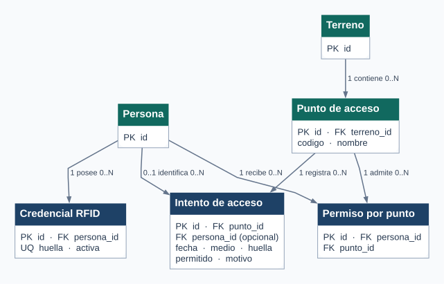
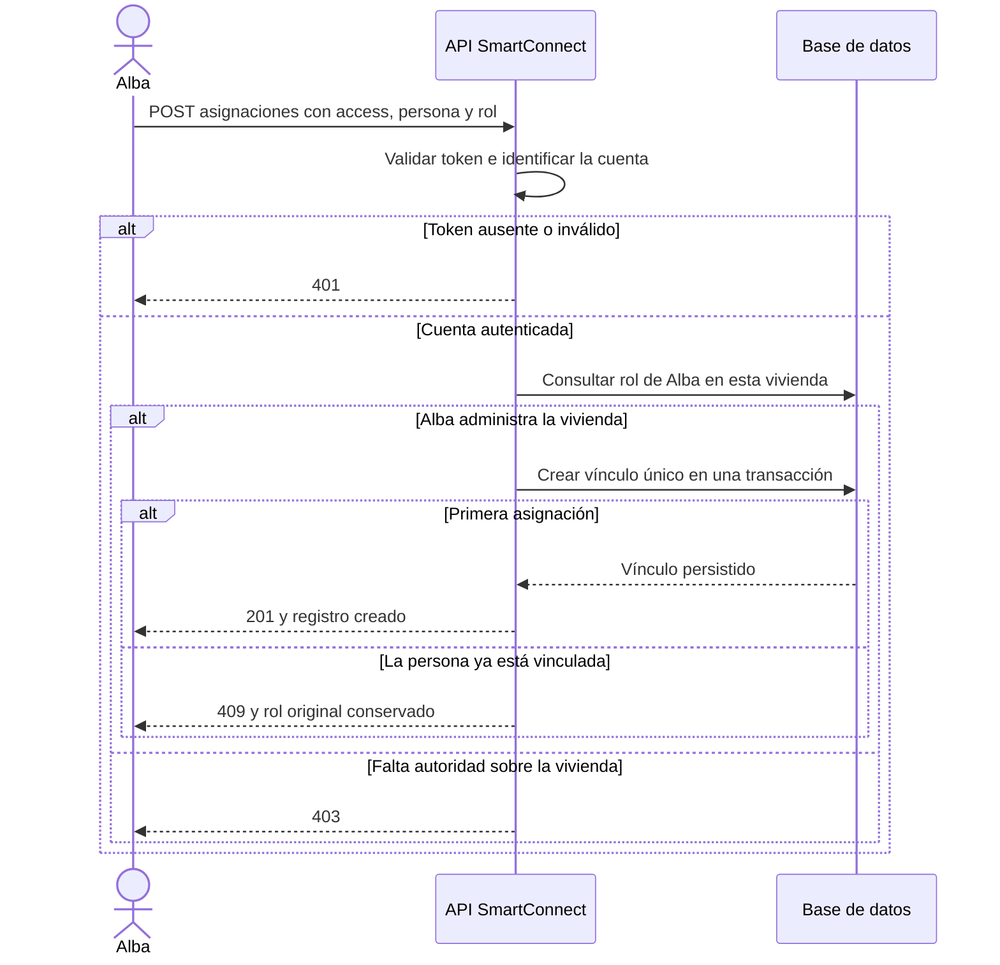

# SmartConnect

**Control de acceso residencial · TI3041 · Unidad 3 · Segundo avance**

Una persona puede administrar una casa en Parque Norte, arrendar un departamento en Mirador Sur y tener permiso para entrar por un único portón. SmartConnect conserva cada relación por separado para poder responder tres preguntas: quién puede asignar residentes, por dónde puede ingresar una persona y qué ocurrió en cada intento.

[](https://github.com/KevinInacap/smartconnect-ti3041/actions/workflows/verificar.yml)

[Instalación](#instalación-local) · [Modelo de datos](#modelo-de-datos) · [Colección de Apidog](apidog/SmartConnect.json) · [Contrato OpenAPI](esquema.yaml) · [Evidencia de ejecución](docs/evidencia-apidog.txt)

## Qué se demuestra

| Criterio de la rúbrica | Demostración reproducible | Evidencia observable |
|---|---|---|
| Cuatro CRUD maestros · 10 puntos | Personas, terrenos, viviendas y puntos de acceso. La colección crea, lista, consulta, reemplaza, modifica y elimina un registro de cada maestro. | Un segundo GET recupera el cambio. La baja devuelve 204 y la consulta posterior 404. Un terreno con viviendas devuelve 409 y sigue disponible. |
| Operación de negocio · 10 puntos | Alba incorpora a una arrendataria en A-01. Se vuelve a intentar con otro rol y después en S-02, donde Alba solo arrienda. | El alta devuelve 201. El duplicado devuelve 409 y la falta de autoridad 403. Apidog compara los listados completos antes y después de cada rechazo. |
| JWT y permisos · 10 puntos | Se obtienen access y refresh, se utiliza el access renovado y se consulta el catálogo desde cuentas distintas. | Sin token se obtiene 401. La trabajadora ve Norte y cero viviendas. Su permiso para usar el portón principal es independiente de su acceso al catálogo. |

## Instalación local

Requiere Python 3.13 y Git. SQLite guarda los datos en `db.sqlite3`. Para ejecutar la colección por consola se necesita también Node.js y npm. La aplicación escucha en la interfaz local del equipo.

```powershell
git clone https://github.com/KevinInacap/smartconnect-ti3041.git
cd smartconnect-ti3041
python -m venv .venv
.\.venv\Scripts\python -m pip install -r requirements.txt
.\.venv\Scripts\python manage.py migrate
.\.venv\Scripts\python manage.py seed_demo
.\.venv\Scripts\python manage.py runserver 127.0.0.1:8000 --insecure
```

En macOS o Linux, el ejecutable del entorno es `.venv/bin/python`. El argumento `--insecure` de **runserver** sirve los archivos estáticos locales de Swagger y Django Admin con DEBUG desactivado. Este procedimiento está pensado para la revisión en el equipo.

Abre [Swagger UI local](http://127.0.0.1:8000/api/docs/). En **POST /api/token/** pulsa **Try it out**, introduce una cuenta de la tabla siguiente y la clave que imprimió la semilla. Copia el valor de `access`, pulsa **Authorize** y pega el token. Para renovarlo, envía `{"refresh": "valor del refresh"}` a **POST /api/token/refresh/** y vuelve a autorizar con el nuevo access.

### Cuentas y datos de prueba

| Usuario | Identidad ficticia | Situación que se puede verificar |
|---|---|---|
| `demo_operador` | Alex Operaciones | Gestiona los cuatro maestros, revisa el historial global y opera el lector RFID simulado. |
| `demo_gestora` | Inés Rojas | Administra dos terrenos y sus viviendas y puntos. La incorporación de residentes exige un rol propio en la vivienda. |
| `demo_duena` | Alba Soto | Propietaria administradora de la casa A-01 en Norte y arrendataria del departamento S-02 en Sur. Puede incorporar residentes en A-01. |
| `demo_residente` | Darío Vega | Propietario administrador de S-02. Puede consultar su terreno y esa vivienda. |
| `demo_trabajador` | Luz Mora | Trabaja en Norte sin vivienda asociada. Tiene permiso para N-01. N-02 produce una denegación. |

La semilla genera una clave local compartida por las cuentas nuevas. Puedes fijarla mediante `SMARTCONNECT_DEMO_PASSWORD` antes de la primera ejecución. Repetir la semilla conserva las claves y los vínculos existentes. Para añadir cuentas desde [Django Admin](http://127.0.0.1:8000/admin/), crea un superusuario local con `python manage.py createsuperuser`, crea el usuario con el formulario de Django y selecciónalo en **Persona → Cuenta**. Para recuperar una clave usa `python manage.py changepassword demo_duena` con el entorno activo. La colección usa la misma clave local para las tres cuentas que autentica.

## Modelo de datos

El ER de la implementación se divide en dos vistas que comparten **Persona** y **Terreno**. Las etiquetas indican las cardinalidades. **PK** identifica la clave primaria, **FK** una referencia y **UQ** una restricción de unicidad.

### Residencia y administración


Cada vivienda pertenece a un solo terreno. Una persona puede administrar varios terrenos y cada terreno tiene una administradora o administrador responsable. La relación muchos a muchos entre persona y vivienda se materializa en **Participación**. El par persona–vivienda es único y su rol puede ser propietario administrador, propietario, arrendatario o conviviente. **Conviviente** representa a quien vive allí sin ser titular ni arrendatario. **Empleo** conserva el vínculo laboral aunque la persona carezca de vivienda.

### Autorización y trazabilidad



Cada punto pertenece a un terreno. **Permiso por punto** vincula una persona con un acceso concreto. La autorización requiere un vínculo territorial vigente y un permiso explícito para ese punto. Para la app también se comprueba el booleano de proximidad simulada. En un intento RFID desconocido queda registrada una huella HMAC del identificador, el punto, la hora y el motivo. La persona queda vacía. La clave de firma local debe conservarse para poder volver a identificar las tarjetas registradas.

| Restricción física | Finalidad |
|---|---|
| Unicidad de `(terreno, codigo)` en vivienda y punto | Los códigos pueden repetirse en terrenos distintos. |
| Unicidad de `(persona, vivienda)`, `(persona, terreno)` en empleo y `(persona, punto)` en permiso | Cada relación tiene una sola fila. |
| Claves foráneas protegidas e índice sobre `intento.fecha` | Las bajas preservan relaciones e historial. La fecha permite acotar consultas. |
| Cuenta opcional y única por persona | Una persona puede recibir una tarjeta antes de tener cuenta en la app. |

Fuentes editables de los diagramas y esquema ejecutable: [residencia](docs/diagramas/residencia.dot), [accesos](docs/diagramas/accesos.dot) y [migración inicial](residencial/migrations/0001_initial.py).

## Operación de negocio



El operador da de alta a la persona en el catálogo. El propietario administrador utiliza su ID para asignarla como arrendataria o conviviente. La designación inicial de propietarios se gestiona en Django Admin por personal autorizado. La regla de la API se comprueba incluso si el solicitante tiene acceso administrativo al catálogo.

## Referencia de la API

Todas las rutas de negocio requieren `Authorization: Bearer <access>`. Las cuatro colecciones maestras aceptan GET y POST. Cada ruta con `{id}/` acepta GET, PUT, PATCH y DELETE.

| Ruta bajo `/api/` | Alcance |
|---|---|
| `personas/` | El operador gestiona el catálogo. Cada persona puede consultar su propia ficha. |
| `terrenos/` | El operador mantiene los terrenos. Administradores, residentes y trabajadores consultan los vinculados. |
| `viviendas/` | El operador y el administrador del terreno mantienen viviendas. Los residentes consultan las que les corresponden. |
| `puntos-acceso/` | El operador y el administrador del terreno mantienen los puntos. Las personas vinculadas pueden ver el catálogo de ese terreno. |
| `viviendas/{id}/asignaciones/` | POST asigna un rol. GET devuelve los vínculos visibles. El residente ordinario ve su propio registro. |
| `accesos/solicitudes/` | POST con `punto`, `medio: "app"` y `cerca`, o con `punto`, `medio: "rfid"` y `uid` desde la cuenta operadora. Tarjeta ficticia conocida: `DEMO-RFID-LUZ`. |
| `historial/` | GET filtra por `persona`, `terreno`, `punto` y `fecha=AAAA-MM-DD` en hora de Chile continental. El operador ve todo, el administrador sus terrenos y cada persona sus propios intentos. |

**Cómo leer las respuestas.** Un 201 en solicitudes de acceso confirma que se guardó el intento. Revisa `permitido` y `motivo` para saber la decisión. Un 403 en una operación administrativa indica que la cuenta carece de autoridad. Las consultas de detalle fuera del listado visible devuelven 404. Los datos inválidos devuelven 400.

## Defensa en Apidog

1. Arranca el servidor e importa [la colección](apidog/SmartConnect.json) en Apidog con la opción de importación de colecciones Postman. Para explorar las operaciones y sus tipos también puedes importar [OpenAPI](esquema.yaml).
2. Configura `baseUrl` como `http://127.0.0.1:8000` y `demoPassword` con la clave local de la semilla. Los scripts guardan access, refresh e IDs en el entorno durante el recorrido.
3. Ejecuta la carpeta **Defensa acumulativa** en orden. Para reproducir exactamente el recorrido verificado, usa el CLI oficial desde la raíz del repositorio en una segunda terminal:

```powershell
$clave = Read-Host "Clave local de la semilla"
npx --yes --package=apidog-cli@2.2.12 apidog run apidog/SmartConnect.json --env-var "demoPassword=$clave" --lang en
```

Cada corrida usa códigos nuevos, borra sus cuatro registros temporales y conserva una arrendataria de demostración y cinco intentos de acceso para que el docente pueda consultarlos después. La colección descubre los IDs de la semilla por código.

Para repetir las pruebas de Django con una base temporal:

```powershell
.\.venv\Scripts\python manage.py test -v 2
.\.venv\Scripts\python manage.py makemigrations --check --dry-run
.\.venv\Scripts\python manage.py spectacular --validate --fail-on-warn
```

### Evidencia, defensa oral y siguiente avance

La ejecución local registrada completó **59 solicitudes HTTP y 98 aserciones en Apidog CLI**, con cero fallos. Django ejecutó **8 pruebas de integración**. El historial público de trabajo incluye [la implementación de la API](https://github.com/KevinInacap/smartconnect-ti3041/pull/1) y la pestaña [Pull requests](https://github.com/KevinInacap/smartconnect-ti3041/pulls?q=is%3Apr+is%3Amerged). Para identificar la versión entregada, consulta la etiqueta `avance-2` y ejecuta `git rev-parse avance-2^{commit}` en Git Bash.

En la defensa, muestra primero el cambio de rol por vivienda, luego el rechazo y la relectura de la BD, y finalmente el historial de Luz. Cada integrante debe identificar su aporte real y explicar una decisión del flujo.

**Supuestos para revisar con el docente.** El conviviente tiene un rol explícito. Los permisos se asignan por punto y se comprueba el vínculo territorial en cada intento. La app declara la proximidad para la práctica y el operador representa al lector RFID. En la integración posterior corresponde acordar cómo verificar la ubicación, autenticar el dispositivo y registrar por separado la confirmación física de apertura.
