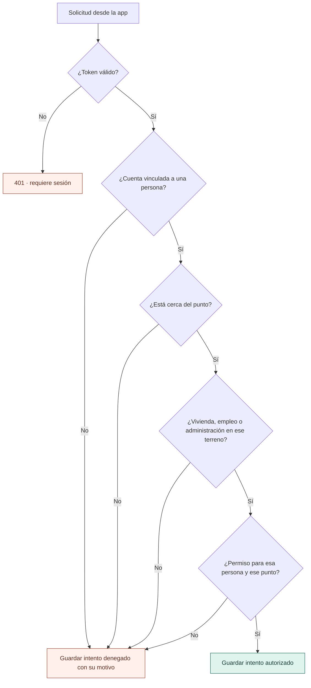
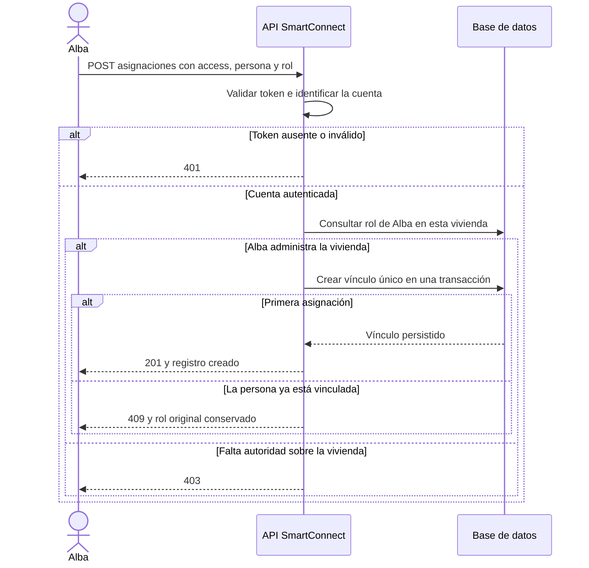

# SmartConnect

**Control de acceso residencial · TI3041 · Unidad 3 · Segundo avance**

Una persona puede administrar una casa en Parque Norte, arrendar un departamento en Mirador Sur y tener permiso para entrar por un único portón. SmartConnect conserva cada relación por separado para poder responder tres preguntas: quién puede asignar residentes, por dónde puede ingresar una persona y qué ocurrió en cada intento.

[](https://github.com/KevinInacap/smartconnect-ti3041/actions/workflows/verificar.yml)

[Instalación](#instalación-local) · [Modelo de datos](#modelo-de-datos) · [Colección de Apidog](apidog/SmartConnect.json) · [Contrato OpenAPI](esquema.yaml) · [Evidencia de ejecución](docs/evidencia-apidog.txt)

## Funciones verificadas

| Operación | Resultado observable |
|---|---|
| Mantener personas, terrenos, viviendas y puntos | Una segunda consulta devuelve el cambio guardado. Borrar un registro libre devuelve 204. Borrar un terreno con viviendas devuelve 409. |
| Asignar residentes a una vivienda | El propietario administrador puede vincular a una persona como arrendataria o conviviente. Un duplicado devuelve 409 y una cuenta sin autoridad recibe 403. |
| Entrar por un punto | La API identifica a la persona por JWT o por su tarjeta. Cada intento registra la decisión, su motivo, el punto y la hora. |

## Instalación local

Requiere Python 3.13 y Git. SQLite guarda los datos en `db.sqlite3`. Para ejecutar la colección por consola se necesita también Node.js y npm. La aplicación escucha en la interfaz local del equipo.

```powershell
git clone https://github.com/KevinInacap/smartconnect-ti3041.git
cd smartconnect-ti3041
python -m venv .venv
.\.venv\Scripts\python -m pip install -r requirements.txt
.\.venv\Scripts\python manage.py migrate
.\.venv\Scripts\python manage.py seed_demo
.\.venv\Scripts\python manage.py runserver 127.0.0.1:8000 --insecure
```

Si estás revisando el pull request antes de su integración, después de `cd smartconnect-ti3041` selecciona `git switch mejora/roles-y-acceso` para disponer de la cuenta de Elena. En macOS o Linux, el ejecutable del entorno es `.venv/bin/python`. El argumento `--insecure` de **runserver** sirve los archivos estáticos locales de Swagger y Django Admin con DEBUG desactivado.

Abre [Swagger UI local](http://127.0.0.1:8000/api/docs/). En **POST /api/token/** pulsa **Try it out**, introduce una cuenta de la tabla siguiente y la clave que imprimió la semilla. Copia el valor de `access`, pulsa **Authorize** y pega el token. Para renovarlo, envía `{"refresh": "valor del refresh"}` a **POST /api/token/refresh/** y vuelve a autorizar con el nuevo access.

### Cuentas y datos de prueba

| Usuario | Identidad ficticia | Situación que se puede verificar |
|---|---|---|
| `demo_operador` | Alex Operaciones | Gestiona los cuatro maestros, revisa el historial global y opera el lector RFID simulado. |
| `demo_gestora` | Inés Rojas | Administra dos terrenos y sus viviendas y puntos. La incorporación de residentes exige un rol propio en la vivienda. |
| `demo_duena` | Alba Soto | Propietaria administradora de la casa A-01 en Norte y arrendataria del departamento S-02 en Sur. Puede incorporar residentes en A-01. |
| `demo_residente` | Darío Vega | Propietario administrador de S-02. Puede consultar su terreno y esa vivienda. |
| `demo_vecina` | Elena Vidal | Arrendataria de A-01 con cuenta estándar. Entra por N-01, recibe una denegación en N-02 y carece de permiso para asignar residentes. |
| `demo_trabajador` | Luz Mora | Trabaja en Norte sin vivienda asociada. Tiene permiso para N-01. N-02 produce una denegación. |

La semilla genera una clave local compartida por las cuentas nuevas. Puedes fijarla mediante `SMARTCONNECT_DEMO_PASSWORD` antes de la primera ejecución. Repetir la semilla conserva las claves y los vínculos existentes. Para añadir cuentas desde [Django Admin](http://127.0.0.1:8000/admin/), crea un superusuario local con `python manage.py createsuperuser`, crea el usuario con el formulario de Django y selecciónalo en **Persona → Cuenta**. Para recuperar una clave usa `python manage.py changepassword demo_duena` con el entorno activo. La colección de acceso residencial inicia sesión como `demo_vecina`.

## Modelo de datos

El ER de la implementación se divide en dos vistas que comparten **Persona** y **Terreno**. Las etiquetas indican las cardinalidades. **PK** identifica la clave primaria, **FK** una referencia y **UQ** una restricción de unicidad.

### Residencia y administración


Cada vivienda pertenece a un solo terreno. Una persona puede administrar varios terrenos y cada terreno tiene una administradora o administrador responsable. La relación muchos a muchos entre persona y vivienda se materializa en **Participación**. El par persona–vivienda es único y su rol puede ser propietario administrador, propietario, arrendatario o conviviente. **Conviviente** representa a quien vive allí sin ser titular ni arrendatario. **Empleo** conserva el vínculo laboral aunque la persona carezca de vivienda.

### Cómo reconoce el sistema a quien llama

| Pregunta | Dato que lee el servidor | Alcance |
|---|---|---|
| ¿Quién inició sesión? | Django valida el usuario y la clave. El access JWT identifica la cuenta y `Persona.cuenta_id` la vincula con su ficha. | Identidad para esta petición. El cliente envía el token. |
| ¿Puede operar el catálogo global? | `User.is_staff` | El operador gestiona los cuatro maestros. |
| ¿Administra este terreno? | `Terreno.administrador_id` coincide con la persona. | Mantener viviendas y puntos de ese terreno. |
| ¿Puede asignar personas a esta vivienda? | Existe la participación de esa persona en **esa vivienda** con `rol = propietario_administrador`. | Incorporar arrendatarios o convivientes. |
| ¿Puede entrar por este portón? | Para app: persona vinculada a la cuenta, cercanía simulada, vínculo vigente con el terreno del punto y fila en `PermisoPunto` para la persona y el punto exactos. | Autorizar ese intento y registrar la decisión. |

**Ejemplo.** Elena usa su propia cuenta. Su ficha registra que arrienda A-01 y que tiene permiso para el portón N-01. El servidor consulta esas relaciones cuando recibe la petición. Si su cuenta aún carece de ficha, la app registra `sin_persona`. Si falta la relación territorial o el permiso específico, registra el motivo correspondiente. Un encargado con los permisos adecuados debe registrar la relación y habilitar el punto durante el alta. Los puntos del modelo actual pertenecen al terreno: el ejemplo representa el portón del conjunto donde está su casa.



### Autorización y trazabilidad


Cada punto pertenece a un terreno. **Permiso por punto** vincula una persona con un acceso concreto. La autorización requiere un vínculo territorial vigente y un permiso explícito para ese punto. Para la app también se comprueba el booleano de proximidad simulada. En un intento RFID desconocido queda registrada una huella HMAC del identificador, el punto, la hora y el motivo. La persona queda vacía. La clave de firma local debe conservarse para poder volver a identificar las tarjetas registradas.

| Restricción física | Finalidad |
|---|---|
| Unicidad de `(terreno, codigo)` en vivienda y punto | Los códigos pueden repetirse en terrenos distintos. |
| Unicidad de `(persona, vivienda)`, `(persona, terreno)` en empleo y `(persona, punto)` en permiso | Cada relación tiene una sola fila. |
| Claves foráneas protegidas e índice sobre `intento.fecha` | Las bajas preservan relaciones e historial. La fecha permite acotar consultas. |
| Cuenta opcional y única por persona | Una persona puede recibir una tarjeta antes de tener cuenta en la app. |

Fuentes editables de los diagramas y esquema ejecutable: [residencia](docs/diagramas/residencia.dot), [accesos](docs/diagramas/accesos.dot) y [migración inicial](residencial/migrations/0001_initial.py).

## Operación de negocio



El operador da de alta a la persona en el catálogo. El propietario administrador utiliza su ID para asignarla como arrendataria o conviviente. La designación inicial de propietarios se gestiona en Django Admin por personal autorizado. La regla de la API se comprueba incluso si el solicitante tiene acceso administrativo al catálogo.

Para habilitar a un nuevo residente, vincula su cuenta con su ficha de persona en Django Admin, asígnale su rol en la vivienda y registra un **Permiso por punto** con su persona y el portón autorizado. A partir de ese momento puede entrar con sus propias credenciales cada vez que se cumplan las condiciones de acceso.

## Referencia de la API

Todas las rutas de negocio requieren `Authorization: Bearer <access>`. Las cuatro colecciones maestras aceptan GET y POST. Cada ruta con `{id}/` acepta GET, PUT, PATCH y DELETE.

| Ruta bajo `/api/` | Alcance |
|---|---|
| `personas/` | El operador gestiona el catálogo. Cada persona puede consultar su propia ficha. |
| `terrenos/` | El operador mantiene los terrenos. Administradores, residentes y trabajadores consultan los vinculados. |
| `viviendas/` | El operador y el administrador del terreno mantienen viviendas. Los residentes consultan las que les corresponden. |
| `puntos-acceso/` | El operador y el administrador del terreno mantienen los puntos. Las personas vinculadas pueden ver el catálogo de ese terreno. |
| `viviendas/{id}/asignaciones/` | POST asigna un rol. GET devuelve los vínculos visibles. El residente ordinario ve su propio registro. |
| `accesos/solicitudes/` | POST con `punto`, `medio: "app"` y `cerca`, o con `punto`, `medio: "rfid"` y `uid` desde la cuenta operadora. Tarjeta ficticia conocida: `DEMO-RFID-LUZ`. |
| `historial/` | GET filtra por `persona`, `terreno`, `punto` y `fecha=AAAA-MM-DD` en hora de Chile continental. El operador ve todo, el administrador sus terrenos y cada persona sus propios intentos. |

**Cómo leer las respuestas.** Un 201 en solicitudes de acceso confirma que se guardó el intento. Revisa `permitido` y `motivo` para saber la decisión. Un 403 en una operación administrativa indica que la cuenta carece de autoridad. Las consultas de detalle fuera del listado visible devuelven 404. Los datos inválidos devuelven 400.

## Usar Apidog con la API local

1. Con el servidor en marcha, abre Apidog de escritorio. En el proyecto entra en **Settings → Import Data**, selecciona [SmartConnect.json](apidog/SmartConnect.json), elige el formato **Postman** si te lo pregunta y confirma. Para trabajar en tu propio equipo también puedes abrir **Offline Space**. [Importación de archivos](https://docs.apidog.com/en/manual-import-633884m0) · [Offline Space](https://docs.apidog.com/en/offline-space-1302680m0)
2. Selecciona un entorno local. Configura `baseUrl` con `http://127.0.0.1:8000` y el **valor local** de `demoPassword` con la clave de la semilla. Verifica que la URL final para el login sea `http://127.0.0.1:8000/api/token/`. [Variables de entorno](https://docs.apidog.com/en/environment-management-584758m0)
3. Abre la carpeta **Acceso de una residente**. Pulsa **Send** en cada petición en el orden de la colección. **Iniciar sesión** obtiene los tokens, **Renovar sesión** guarda el access renovado y las consultas posteriores guardan en el entorno los ID reales. Si el access vence, vuelve a ejecutar **Renovar sesión**.
4. En **Mi rol en A-01** verás `rol: arrendatario`. En **Entrar por el portón** verás `permitido: true`; en **Intentar la puerta de servicio**, `permitido: false`. Las dos respuestas tienen estado 201 porque ambas crearon un intento. **Asignar como residente** devuelve 403 y **Mi historial** muestra ambas decisiones.
5. Para trabajar con los cuatro CRUD, importa también [esquema.yaml](esquema.yaml) como **OpenAPI** en un proyecto o módulo separado, con la misma URL base. Envía **POST /api/token/** con `demo_operador`, copia el `access` y úsalo en **Auth → Bearer Token**. En `/api/personas/`, por ejemplo, crea una persona con `{"codigo":"visita-01","nombre":"Visita de prueba"}` y consulta `GET /api/personas/{id}/` con el ID recibido. Usa un código nuevo por ejecución.

Para ejecutar la colección local con el cliente oficial de consola:

```powershell
$clave = Read-Host "Clave local de la semilla"
npx --yes --package=apidog-cli@2.2.12 apidog run apidog/SmartConnect.json --env-var "demoPassword=$clave" --lang en
```

El recorrido envía diez peticiones. Cada ejecución guarda dos intentos que después aparecen en el historial de Elena. Para probar el backend con una base temporal, ejecuta `.\.venv\Scripts\python manage.py test -v 2`. [Evidencia de Apidog](docs/evidencia-apidog.txt) · [Pruebas de integración](residencial/tests.py)

**Supuestos para revisar con el docente.** El conviviente tiene un rol explícito. Los permisos se asignan por punto y se comprueba el vínculo territorial en cada intento. La app declara la proximidad para la práctica y el operador representa al lector RFID. En la integración posterior corresponde acordar cómo verificar la ubicación, autenticar el dispositivo y registrar por separado la confirmación física de apertura.
