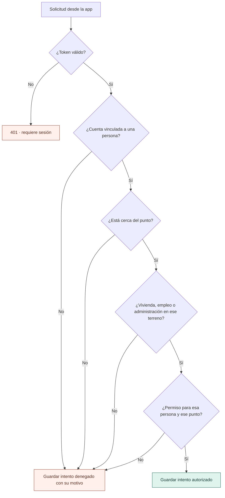
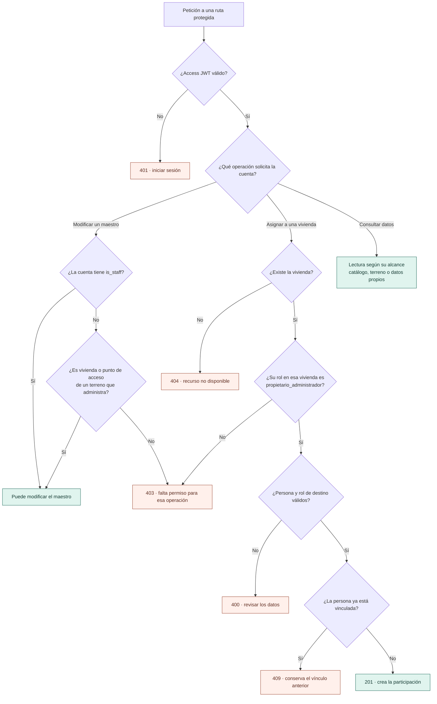

# SmartConnect

**Control de acceso residencial · TI3041 · Unidad 3 · Segundo avance**

Una persona puede administrar una casa en Parque Norte, arrendar un departamento en Mirador Sur y tener permiso para entrar por un único portón. SmartConnect conserva cada relación por separado para poder responder tres preguntas: quién puede asignar residentes, por dónde puede ingresar una persona y qué ocurrió en cada intento.

[](https://github.com/KevinInacap/smartconnect-ti3041/actions/workflows/verificar.yml)

[Guía para la clase](#guía-para-la-clase) · [Modelo de datos](#modelo-de-datos) · [Referencia de la API](#referencia-de-la-api) · [Evidencia de las pruebas](#pruebas-reproducibles)

## Empezar en el PC de clase

Si ya tienes la copia preparada en Windows, abre **Iniciar SmartConnect.cmd** con doble clic. El archivo usa el Python del equipo, aplica las migraciones, carga los usuarios ficticios e inicia Django en el puerto 8000. Mantén abierta la ventana si acaba de arrancar el servidor. [Archivo de inicio](<Iniciar SmartConnect.cmd>)

- **Apidog** envía las peticiones al servidor de este PC. Abre el proyecto **SmartConnect · Acceso residencial** y selecciona el entorno que apunta a `http://127.0.0.1:8000`. [Proyecto de la clase](https://app.apidog.com/project/1420338)
- **Historial** muestra los últimos 50 intentos visibles para la cuenta. Abre la página en otra pestaña, inicia sesión como Scarlett y déjala abierta para la demostración. [Historial en este PC](http://127.0.0.1:8000/historial/)
- **Swagger** sirve para explorar todas las rutas. **Django Admin** permite a Kevin consultar los registros de los cuatro maestros, las participaciones y los intentos. [Swagger](http://127.0.0.1:8000/api/docs/) · [Django Admin](http://127.0.0.1:8000/admin/)

### Cuentas de clase

| Usuario | Clave de práctica | Qué puedes mostrar |
|---|---|---|
| `aula_scarlett` | `Scarlett-Aula-TI3041!` | Arrendataria de A-01. Puede entrar por N-01, recibe una denegación en N-02 y puede consultar sus propios intentos. |
| `aula_kevin` | `Kevin-Aula-TI3041!` | Operador de los cuatro maestros en la API, con lectura del historial global. También es propietario administrador de A-01 y puede asignar residentes allí. |

Estas identidades son datos ficticios elegidos para el ejercicio. Las claves de esta tabla son públicas y se habilitan expresamente con `seed_demo --aula` para una instancia local con datos de ejemplo. En la colección actual el login ya incluye la cuenta y la clave de práctica. Puedes comenzar sin crear `demoPassword`. Repetir la semilla conserva las contraseñas que ya existan.

### Crear una cuenta desde Apidog

Envía `POST http://127.0.0.1:8000/api/usuarios/` con **Auth → No Auth** y un cuerpo JSON como el siguiente.

```json
{
  "username": "compa01",
  "password": "Patio-Clase-27!"
}
```

Elige un nombre disponible, sin espacios, y una contraseña de 8 a 128 caracteres. Un `201` devuelve el `id` y el `username` guardados en Django. Un nombre repetido o datos inválidos devuelven `400`. Envía el mismo JSON a `POST /api/token/` para obtener los tokens y usa `access` como Bearer en las rutas protegidas.

La cuenta nueva empieza con permisos estándar. En Django Admin, un superusuario puede verla en **Usuarios** y vincularla desde **Personas → Cuenta**. Los roles de cada vivienda se asignan desde **Participaciones**. `aula_kevin` sirve para consultar los registros de clase. Para administrar cuentas, crea tu propio superusuario con `python manage.py createsuperuser`. [Colección de registro y login](apidog/RegistroUsuarios.json) · [Panel local](http://127.0.0.1:8000/admin/)

## Guía para la clase

Abre al mismo tiempo **Apidog** y el **Historial**. Las peticiones de la carpeta **Acceso de una residente** están ordenadas. Pulsa **Enviar** en cada una, desde la primera. El login y las consultas guardan en el entorno los tokens y los identificadores que utilizan los pasos siguientes.

| En Apidog | Qué mostrar y cómo explicarlo |
|---|---|
| 1. **Viviendas sin sesión** | `401`. La API exige que la persona se identifique. |
| 2–3. **Iniciar sesión** y **Renovar sesión** | `200`. El login de Scarlett entrega `access` y `refresh`. El siguiente paso obtiene un nuevo `access`. Apidog lo envía en el encabezado `Authorization: Bearer …`. |
| 4–7. **Mi terreno**, **Mis viviendas**, **Mi rol en A-01** y **Puntos de mi terreno** | Se identifica Parque Norte, su vivienda A-01, su rol de arrendataria y los dos puntos de ese terreno. Conocer un punto y tener permiso para utilizarlo son dos comprobaciones distintas. |
| 8. **Entrar por el portón** | `201`, `permitido: true`, `motivo: autorizado`. Lee el `id` de la respuesta. Cambia a la pestaña Historial y busca la fila con ese mismo ID, Scarlett y N-01. Se actualiza cada tres segundos mientras está visible. |
| 9. **Intentar la puerta de servicio** | `201`, `permitido: false`, `motivo: sin_permiso_punto`. El segundo ID aparece como **Denegado** junto a N-02. El 201 indica que se guardó el intento. |
| 10–11. **Asignar como residente** y **Mi historial** | `403` al intentar asignar a otra persona. Con **Mi historial** se recuperan ambos intentos en JSON. |

**Para explicar la persistencia:** “Apidog envió un POST. Django identificó la cuenta por su JWT, comprobó el permiso del punto y guardó la decisión en SQLite. El GET del historial y el panel consultan esa misma fila. Aquí se ve el mismo ID”. El login y las consultas GET no crean intentos. La proximidad se simula con `cerca`. La confirmación de una apertura física corresponde a la integración del dispositivo.

**Para mostrar la rúbrica completa**, usa la colección **Rúbrica**. Kevin ejecuta los cuatro CRUD y asigna a una arrendataria en A-01 (`201`). El duplicado recibe `409`. Scarlett recibe `403` al asignar en A-01 y Kevin recibe `403` al intentar asignar en S-02, donde carece del rol de propietario administrador. Las relecturas verifican que los rechazos conservaron las relaciones. El recorrido utiliza códigos nuevos por ejecución y conserva la asignación de ejemplo. [Colección con los cuatro CRUD y la operación de negocio](apidog/Rubrica.json)

### Preparación en otro equipo

Con Python 3.12 o 3.13, Git y, para ejecutar las colecciones por consola, Node.js con npm, clona el repositorio.

```powershell
git clone https://github.com/KevinInacap/smartconnect-ti3041.git
cd smartconnect-ti3041
& '.\Iniciar SmartConnect.cmd'
```

La instalación manual equivalente empieza con `python -m venv .venv`. Activa ese entorno y ejecuta `python -m pip install -r requirements.txt`, `python manage.py migrate`, `python manage.py seed_demo --aula` y `python manage.py runserver 127.0.0.1:8000 --insecure`. Django usa el argumento `--insecure` para servir los archivos estáticos locales de Swagger y Admin durante la práctica.

En Apidog, importa [SmartConnect.json](apidog/SmartConnect.json), [Rubrica.json](apidog/Rubrica.json) y [RegistroUsuarios.json](apidog/RegistroUsuarios.json) como colecciones Postman en módulos separados. Conserva los casos con el mismo método y URL, junto con sus postprocesadores. El [contrato OpenAPI](esquema.yaml) documenta los endpoints y sus respuestas. Usa `http://127.0.0.1:8000` como URL base del entorno local y como valor de `baseUrl` si las peticiones importadas usan esa variable. [Guía de importación de Postman](https://docs.apidog.com/import-from-postman-635043m0)

**Si hay un error en Apidog**

| Qué ves | Qué revisar |
|---|---|
| Error de conexión | Abre el historial local. Si tampoco carga, inicia SmartConnect en ese mismo PC. En Apidog web selecciona un agente local que pueda llegar a localhost, o abre el proyecto en Apidog de escritorio. |
| `401` en **Iniciar sesión** | Revisa el cuerpo JSON de **POST /api/token/**. Usa el usuario y la clave de Scarlett de la tabla. Si el cuerpo todavía contiene `{{demoPassword}}`, estás usando una copia anterior. |
| `401` después de un login correcto | Selecciona el mismo entorno y vuelve a ejecutar login y renovación. En las rutas protegidas revisa el encabezado Bearer y que los postprocesadores estén habilitados. |
| `400` o una URL con `{{casa_residente}}` o `{{principal}}` sin resolver | Ejecuta las consultas 4 a 7 en orden. Son las que obtienen los ID de **tu** base de datos. |
| Apidog marca en rojo «se esperaba 200» | Mira el **estado real**, el **Body** y el paso de la guía. Algunas definiciones importadas tienen validación genérica de éxito 200. Para las aperturas el resultado esperado es 201, y en las pruebas de rechazo se esperan 401, 403 o 409 según el caso. Las aserciones de la colección comprueban esos códigos. |

## Modelo de datos

El ER de la implementación se divide en dos vistas que comparten **Persona** y **Terreno**. Las etiquetas indican las cardinalidades. **PK** identifica la clave primaria, **FK** una referencia y **UQ** una restricción de unicidad.

### Residencia y administración


Cada vivienda pertenece a un solo terreno. Una persona puede administrar varios terrenos y cada terreno tiene una administradora o administrador responsable. La relación muchos a muchos entre persona y vivienda se materializa en **Participación**. El par persona–vivienda es único y su rol puede ser propietario administrador, propietario, arrendatario o conviviente. **Conviviente** representa a quien vive allí sin ser titular ni arrendatario. **Empleo** conserva el vínculo laboral aunque la persona carezca de vivienda.

### Cómo reconoce el sistema a quien llama

| Pregunta | Dato que lee el servidor | Alcance |
|---|---|---|
| ¿Quién inició sesión? | Django valida el usuario y la clave. El access JWT identifica la cuenta y `Persona.cuenta_id` la vincula con su ficha. | Identidad para esta petición. El cliente envía el token. |
| ¿Puede operar el catálogo global? | `User.is_staff` | El operador gestiona los cuatro maestros. |
| ¿Administra este terreno? | `Terreno.administrador_id` coincide con la persona. | Mantener viviendas y puntos de ese terreno. |
| ¿Puede asignar personas a esta vivienda? | Existe la participación de esa persona en **esa vivienda** con `rol = propietario_administrador`. | Incorporar arrendatarios o convivientes. |
| ¿Puede entrar por este portón? | Para app: persona vinculada a la cuenta, cercanía simulada, vínculo vigente con el terreno del punto y fila en `PermisoPunto` para la persona y el punto exactos. | Autorizar ese intento y registrar la decisión. |

**Ejemplo.** Scarlett usa su propia cuenta. Su ficha registra que arrienda A-01 y que tiene permiso para el portón N-01. El servidor consulta esas relaciones cuando recibe la petición. Si su cuenta aún carece de ficha, la app registra `sin_persona`. Si falta la relación territorial o el permiso específico, registra el motivo correspondiente. Un encargado con los permisos adecuados debe registrar la relación y habilitar el punto durante el alta. Los puntos del modelo actual pertenecen al terreno: el ejemplo representa el portón del conjunto donde está su casa.



### Autorización y trazabilidad


Cada punto pertenece a un terreno. **Permiso por punto** vincula una persona con un acceso concreto. La autorización requiere un vínculo territorial vigente y un permiso explícito para ese punto. Para la app también se comprueba el booleano de proximidad simulada. En un intento RFID desconocido queda registrada una huella HMAC del identificador, el punto, la hora y el motivo. La persona queda vacía. La clave de firma local debe conservarse para poder volver a identificar las tarjetas registradas.

| Restricción física | Finalidad |
|---|---|
| Unicidad de `(terreno, codigo)` en vivienda y punto | Los códigos pueden repetirse en terrenos distintos. |
| Unicidad de `(persona, vivienda)`, `(persona, terreno)` en empleo y `(persona, punto)` en permiso | Cada relación tiene una sola fila. |
| Claves foráneas protegidas e índice sobre `intento.fecha` | Las bajas preservan relaciones e historial. La fecha permite acotar consultas. |
| Cuenta opcional y única por persona | Una persona puede recibir una tarjeta antes de tener cuenta en la app. |

Fuentes editables de los diagramas y esquema ejecutable: [residencia](docs/diagramas/residencia.dot), [accesos](docs/diagramas/accesos.dot) y [migración inicial](residencial/migrations/0001_initial.py).

## Comprobación de permisos por operación



`is_staff` da acceso global al catálogo. `Terreno.administrador_id` da autoridad sobre las viviendas y los puntos de ese terreno. `Participacion.rol` da autoridad para asignar arrendatarios o convivientes en una vivienda concreta. Una cuenta puede reunir varios permisos. El JWT identifica la cuenta y la API consulta sus permisos para cada operación.

| Cuenta en Apidog | Operación | Respuesta esperada |
|---|---|---|
| Sin sesión | `GET /api/viviendas/` | `401` |
| Kevin, operador global | `POST /api/personas/` | `201` con los datos válidos |
| Kevin, propietario administrador de A-01 | `POST /api/viviendas/{id}/asignaciones/` para A-01 | `201` con la primera asignación y `409` al repetirla |
| Kevin, sin autoridad sobre S-02 | La misma asignación para S-02 | `403` |
| Scarlett, arrendataria de A-01 | `GET` y `POST` de asignaciones para A-01 | `200` con su propio vínculo y `403` al intentar asignar |

El operador da de alta a la persona en el catálogo. El propietario administrador utiliza su ID para asignarla como arrendataria o conviviente. La designación inicial de propietarios se gestiona en Django Admin por personal autorizado.

Para habilitar a un nuevo residente, vincula su cuenta con su ficha de persona en Django Admin, asígnale su rol en la vivienda y registra un **Permiso por punto** con su persona y el portón autorizado. A partir de ese momento puede entrar con sus propias credenciales cada vez que se cumplan las condiciones de acceso.

## Referencia de la API

El registro y el inicio de sesión son públicos. Las rutas de negocio requieren `Authorization: Bearer <access>`. Las cuatro colecciones maestras aceptan GET y POST. Cada ruta de maestro con `{id}/` acepta GET, PUT, PATCH y DELETE.

| Ruta bajo `/api/` | Alcance |
|---|---|
| `usuarios/` | POST crea una cuenta estándar con `username` y `password`. |
| `token/` y `token/refresh/` | POST inicia sesión o renueva el access JWT. |
| `personas/` | El operador gestiona el catálogo. Cada persona puede consultar su propia ficha. |
| `terrenos/` | El operador mantiene los terrenos. Administradores, residentes y trabajadores consultan los vinculados. |
| `viviendas/` | El operador y el administrador del terreno mantienen viviendas. Los residentes consultan las que les corresponden. |
| `puntos-acceso/` | El operador y el administrador del terreno mantienen los puntos. Las personas vinculadas pueden ver el catálogo de ese terreno. |
| `viviendas/{id}/asignaciones/` | POST asigna un rol. GET devuelve los vínculos visibles. El residente ordinario ve su propio registro. |
| `accesos/solicitudes/` | POST con `punto`, `medio: "app"` y `cerca`, o con `punto`, `medio: "rfid"` y `uid` desde la cuenta operadora. Tarjeta ficticia conocida: `DEMO-RFID-LUZ`. |
| `historial/` | GET filtra por `persona`, `terreno`, `punto` y `fecha=AAAA-MM-DD` en hora de Chile continental. El operador ve todo, el administrador sus terrenos y cada persona sus propios intentos. |

**Cómo leer las respuestas.** Un 201 en solicitudes de acceso confirma que se guardó el intento. Revisa `permitido` y `motivo` para saber la decisión. Un 403 en una operación administrativa indica que la cuenta carece de autoridad. Las consultas de detalle fuera del listado visible devuelven 404. Los datos inválidos devuelven 400.

## Pruebas reproducibles

Con el servidor local encendido y los datos de clase cargados, abre una segunda terminal en el repositorio:

```powershell
npx --yes --package=apidog-cli@2.2.12 apidog run apidog/SmartConnect.json --lang en
npx --yes --package=apidog-cli@2.2.12 apidog run apidog/Rubrica.json --lang en
npx --yes --package=apidog-cli@2.2.12 apidog run apidog/RegistroUsuarios.json --lang en
.\.venv\Scripts\python manage.py test
```

| Prueba | Resultado verificado |
|---|---|
| Acceso de Scarlett · Apidog CLI | 11 peticiones y 23 aserciones aprobadas. [Registro](docs/evidencia-apidog.txt) |
| Cuatro CRUD, JWT y asignaciones · Apidog CLI | 53 peticiones y 87 aserciones aprobadas. [Registro](docs/evidencia-rubrica.txt) |
| Registro de usuarios · Apidog CLI | 7 peticiones y 14 aserciones aprobadas. Cubren alta, duplicado, validación, login y permisos iniciales. |
| Backend · Django | 17 pruebas aprobadas. Incluyen registro, login, permisos y trazabilidad. |

**Decisión para el siguiente avance.** Las autorizaciones se conceden por persona y punto. La app usa proximidad simulada y el operador representa al lector RFID. La integración física tendrá que registrar una confirmación del dispositivo después de la autorización.
